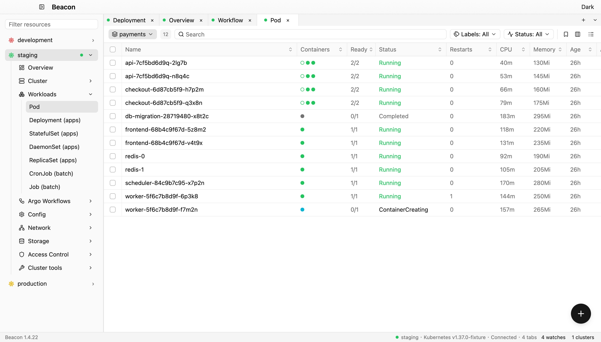
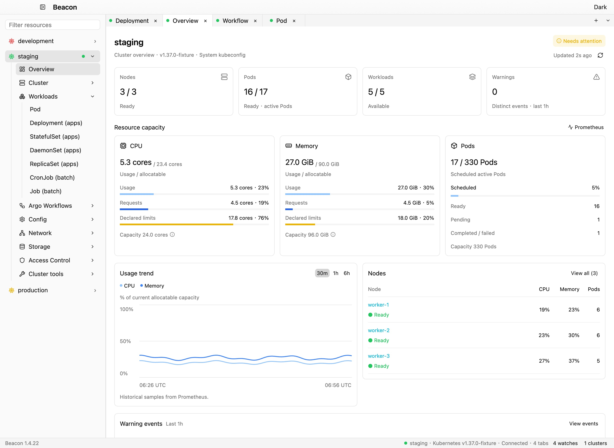
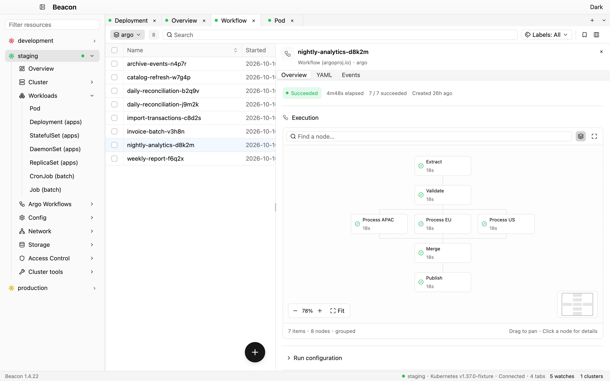

<p align="center">
  
</p>

<h1 align="center">Beacon</h1>

<p align="center">
  <a href="README.md">English</a> · <strong>简体中文</strong>
</p>

<p align="center">
  <strong>一个原生 Kubernetes 桌面客户端</strong><br>
  多集群浏览 · 实时资源视图 · Pod 终端 · 自定义主题
</p>

<p align="center">
  <a href="https://github.com/yoogoc/beacon/actions/workflows/ci.yml"></a>
  
  
  <a href="Cargo.toml"></a>
</p>

<p align="center">
  <a href="#快速开始">快速开始</a> ·
  <a href="#编辑资源">编辑资源</a> ·
  <a href="docs/USAGE.md">使用指南</a> ·
  <a href="https://github.com/yoogoc/beacon/releases">下载构建</a> ·
  <a href="docs/DEVELOPMENT.md">开发指南</a>
</p>

<p align="center">
  <picture>
    <source media="(prefers-color-scheme: dark)" srcset="docs/images/workspace-dark.jpg">
    <source media="(prefers-color-scheme: light)" srcset="docs/images/workspace-light.jpg">
    
  </picture>
</p>

<p align="center">
  <sub>当前版本的应用界面，使用本地演示数据渲染；根据浏览器的深浅色偏好显示。</sub>
</p>

<details>
  <summary><strong>集群 Overview · 容量与趋势</strong></summary>

  <p align="center">
    <picture>
      <source media="(prefers-color-scheme: dark)" srcset="docs/images/cluster-overview-dark.jpg">
      <source media="(prefers-color-scheme: light)" srcset="docs/images/cluster-overview-light.jpg">
      
    </picture>
  </p>
</details>

<details>
  <summary><strong>Argo Workflows · 自适应执行画布</strong></summary>

  <p align="center">
    <picture>
      <source media="(prefers-color-scheme: dark)" srcset="docs/images/workflow-dark.jpg">
      <source media="(prefers-color-scheme: light)" srcset="docs/images/workflow-light.jpg">
      
    </picture>
  </p>
</details>

Beacon 使用 Rust 和 GPUI 构建，将集群、资源列表、详情和容器工具放进一个桌面工作区。
沿用现有 kubeconfig 和集群权限，内置资源与 CRD 都由集群动态发现；不必为每个新资源安装额外插件。

## 功能

| 功能 | 可以做什么 |
| --- | --- |
| **多集群工作区** | 从左侧集群树切换上下文；多个集群保持连接；支持 EKS 名称识别、别名、自定义图标、主动断开和重连。 |
| **集群概览** | 查看健康状态、CPU / 内存 / Pod 容量、资源请求与声明的限制、节点摘要及近期告警；Kubernetes Metrics API 使用会话采样，Prometheus 支持 30m / 1h / 6h 历史趋势；节点与事件详情通过侧边浮层显示。 |
| **资源与 CRD** | 实时 Watch 更新；内置资源使用 kubectl 风格列；动态读取 CRD 的 `additionalPrinterColumns`。 |
| **节点** | 查看污点、EKS 节点组和节点上的 Pod；支持 Cordon / Uncordon，Drain 前审阅受影响 Pod 与中断预算，执行后查看逐项驱逐结果。 |
| **搜索与筛选** | 模糊搜索、排序、命名空间多选、Kubernetes Label 选择器；按 Pod / Deployment 状态、Service 类型、Ingress Class、PVC 属性、Secret 类型和 CRD Scope 筛选。 |
| **全局搜索与收藏** | 在已连接集群和命名空间间搜索资源；收藏集群与资源，快速打开常用对象。 |
| **列表个性化** | 选择显示列、拖动表头排序、调整列宽；按集群和资源类型保存布局与排序，命名并复用常用筛选组合。 |
| **关联资源** | 在独立的 Related 详情页实时查看并跳转 Deployment 的 ReplicaSet / Pod、Service 的 EndpointSlice / Pod，以及使用 PVC 的 Pod。 |
| **配置引用关系** | 查看哪些 Pod 和工作负载使用了 ConfigMap / Secret，展示引用的 Key、环境变量及挂载路径；提示缺失引用并跳转到使用方。 |
| **资源详情** | Overview、YAML、Events；可复制的字段、折叠的标签和注解；容器端口、资源请求与限制、探针、环境变量与挂载；点击 Owner 跳转。 |
| **YAML 编辑器** | Schema 字段补全、字段说明、行内校验、格式化和可配置的字段折叠；保存前审阅差异，默认使用带版本校验的 Patch，也可选择 Server-Side Apply。 |
| **Argo Workflows** | 独立资源分组、Workflow 与模板执行图、CronWorkflow 历史及独立节点详情；支持填写参数提交模板，以及 Retry、Resubmit、Suspend / Resume、Stop / Terminate，操作前审阅并检查权限。 |
| **Pod 工具** | 日志关键字搜索与高亮、暂停 / 继续跟随、跳到最新、自动换行、容器选择和日志下载；独立底部面板提供 Exec、Shell 和端口转发，用实心 / 空心圆显示普通 / Init 容器状态。 |
| **结构化日志** | 检视 JSON / logfmt 字段，按等级、正则、字段和时间范围筛选，标记日志书签并导出当前保留的匹配日志；Pod 日志和聚合日志均支持。 |
| **Pod 文件** | 从 Pod 右键菜单打开独立 Files 标签页，浏览运行中的容器、预览文本与文件信息、保存前确认 Diff、上传与选择文件夹下载；支持目录打包下载、新建目录、重命名和表格确认多选删除。需要 `pods/exec` 权限、容器 Shell 及 GNU/BusyBox 文件工具；打包下载需要 `tar`。 |
| **日志聚合** | 按工作负载或 Label 跟踪多个 Pod，逐行标明 Pod / 容器和时间；新副本自动加入，支持搜索、暂停、换行和选择文件夹批量下载。 |
| **部署历史** | 查看保留的版本、镜像及创建时间，回滚前预览模板差异并确认，实时查看部署进度。 |
| **Job 与 CronJob** | 立即执行 CronJob、暂停或恢复定时调度，将 Job 复制为新的 Job 重跑并保留原记录；继续追踪生成的 Job、Pod 和日志。 |
| **临时调试容器** | 为运行中的 Pod 添加临时容器，选择镜像、目标容器和安全配置，随后打开终端。 |
| **网络链路** | 查看 Ingress → Service → EndpointSlice → Pod 关系，提示缺失引用、未就绪端点及端口不匹配，点击节点跳转资源。 |
| **资源对比** | 在已连接集群或命名空间间选择资源，通过独立只读窗口对比 YAML；默认忽略运行时字段并遮盖 Secret 值。 |
| **资源写操作** | YAML 创建与服务端预校验，保存前审阅差异；支持重启、扩缩容、Deployment 批量重启和多资源删除，批量操作展示逐项结果；行末与右键菜单共用资源操作及权限判断。 |
| **ConfigMap 与 Secret** | 可搜索的虚拟 Key 列表与单值编辑区，支持高亮、折叠、拖拽高度和横向滚动；可标记整项 Key / Value 删除并在保存前恢复；Secret 默认遮盖，TLS 详情包含主题、签发者、有效期、算法、强度、扩展和公钥。 |
| **指标** | 查看 Pod / Node / Container 的 CPU、内存趋势、Requests / Limits，以及重启和 OOM 标记；使用 Kubernetes Metrics API 会话采样或 Prometheus 历史数据。 |
| **Helm** | 查看 Release 的 Values、Manifest、历史版本与版本间差异；支持审阅后安装、升级、回滚和卸载，并展示操作进度；生命周期操作使用本机 `helm` CLI。 |
| **RBAC 权限查看** | 通过服务端 **Can I?** 检查当前用户或其他主体的权限，追溯 Binding → Role → Rules，并从 403 错误进入权限详情。 |
| **端口转发** | 以 Pod、Service 或 Deployment 为目标，指定本地端口、保存常用配置并显式恢复；后端 Pod 替换后可重新选择目标并恢复转发。 |
| **应用更新** | 自动检查、可选自动下载、更新包验签、Stable / Development 渠道；安装前确认重启并保护未应用的资源编辑。 |
| **外观与连接** | 浅色、深色、命名的自定义主题；字体和颜色配置保存到本地；全局代理与集群独立代理。 |
| **语言** | 支持英文和简体中文，默认跟随系统。在设置 → 外观中切换后，已打开的窗口和菜单立即更新。 |
| **诊断与键盘操作** | 命令面板、可搜索的快捷键指南、独立的应用日志窗口；底部可查看连接和 Watch 状态。 |

## 快速开始

### 下载构建

在 [Releases](https://github.com/yoogoc/beacon/releases) 查找对应平台的产物。
push 到 `main` 不会自动构建或发布安装包。
正式 `vX.Y.Z` 标签必须与 Cargo 版本一致；全部平台打包成功后发布正式 Release 并标记为 **Latest**。
版本选择和操作步骤见[正式发版流程](docs/PACKAGING.md#版本规则与正式发版)。手动运行打包任务的产物位于
[Actions](https://github.com/yoogoc/beacon/actions/workflows/package.yml)。

| 平台 | 打包格式 | 验证情况 |
| --- | --- | --- |
| macOS · Apple Silicon / Intel | `.app`、`.dmg` | 已在本机验证构建、打包与启动；签名和公证尚未验证。 |
| Linux · x86_64 / ARM64 | `.deb`、AppImage | 已配置打包任务，本机尚未验证。 |
| Windows · x86_64 / ARM64 | NSIS 安装包 | 已配置打包任务，本机尚未验证。 |

实际可用产物以 Release 和 Actions 结果为准。详情见 [打包与分发](docs/PACKAGING.md)。

### 从源码运行

准备 Rust 工具链和平台构建依赖；仓库的 `rust-toolchain.toml` 固定使用 Rust 1.98。
macOS 需要 Xcode Command Line Tools；Linux 的系统依赖、Windows 的 MSVC 环境见
[开发指南](docs/DEVELOPMENT.md)。

```sh
git clone https://github.com/yoogoc/beacon.git
cd beacon
cargo run --locked
```

Beacon 读取 `KUBECONFIG`，未设置时读取 `~/.kube/config`。如需指定配置：

```sh
KUBECONFIG=/path/to/kubeconfig cargo run --locked
```

在 **Settings → Kubeconfigs** 中可添加多个本地文件、扫描目录或粘贴 YAML。
添加前先预览并选择 context，来源设置自动保存；引用原文件保持原位，粘贴的配置
以私有文件保存在 Beacon 的配置目录。在 **Settings → Workspace** 中可选择可折叠的来源
分组或带来源标签的平铺列表。多个有效来源时显示归属，同一目录内重名的 context 通过文件名区分。

首次启动后：

1. 点击左侧集群名称进行连接。
2. 展开资源分组，选择 Pod、Deployment 或其他资源类型。
3. 点击资源查看详情；右键使用该资源支持的操作。

**启动时不自动连接任何集群，连接后也不自动打开资源列表。**
使用 kubeconfig 凭据插件时，需要对应命令在 PATH 上；集群拒绝 WebSocket Exec 升级时，
Shell / Exec 可自动回退到本机 `kubectl`。

## 工作区与键盘操作

点击资源类型会复用当前分屏内**同一集群、同一类型**的标签页；右键选择 **Open in new tab** 可打开另一个视图。
每个标签页独立保留命名空间、搜索、筛选和详情状态。侧边栏位于标签页外，侧边栏、右侧详情和底部 Pod 面板均可拖拽调整大小。

右键标签页可向右 / 向下分屏，或移到独立窗口；分屏支持嵌套和拖拽缩放。
拖动标签页到其他标签组或窗口可合并，拖到分屏边缘可创建新分屏。
移动时保留资源视图、YAML 草稿和 Pod 工具，各窗口共享集群连接与 Watch。

| 功能 | macOS | Windows / Linux |
| --- | --- | --- |
| 命令面板 | `⌘ K` | `Ctrl K` |
| 新建 / 关闭标签页 | `⌘ T` / `⌘ W` | `Ctrl T` / `Ctrl W` |
| 下一个 / 上一个标签页 | `Ctrl Tab` / `Ctrl Shift Tab` | `Ctrl Tab` / `Ctrl Shift Tab` |
| 向右 / 向下分屏 | `⌘ ⌥ →` / `⌘ ⌥ ↓` | `Ctrl Alt →` / `Ctrl Alt ↓` |
| 应用设置 | `⌘ ,` | `Ctrl ,` |
| 应用日志 | `⌘ Shift L` | `Ctrl Shift L` |
| 快捷键指南 | `F1` | `F1` |

命令面板支持 `@资源类型`、`#命名空间`、`ctx 集群` 和 `>命令`。
例如 `@dep` 查找 Deployment，`#kube-sys` 查找 kube-system。
完整快捷键和焦点行为可在 **Help → Keyboard shortcuts** 中查看。

## 编辑资源

### YAML

1. 打开资源的 **YAML** 页，使用字段补全、说明和行内校验进行编辑。
2. 点击 **Save** 准备差异；默认通过 Patch 只保存修改的字段，并校验资源 UID 与版本。
3. 在并排 Diff 中审阅修改，点击 **Confirm & save** 确认写入。

如果资源在服务端发生变化，草稿会保留。**Review latest** 将本地改动合入最新资源，同时保留未编辑字段的最新值；重新审阅差异后再确认。
需要管理字段所有权时，可主动选择 **Server-Side Apply**；仅真正的所有权冲突才提供需要单独审阅的强制应用操作。

### ConfigMap 与 Secret

打开 **Data**，搜索并选择 Key 后查看和编辑值。列表只渲染可见行，编辑器和语法分析按需加载；切换 Key 时保留未保存的修改。

- 按内容识别格式并高亮，支持代码折叠和拖拽调整编辑区高度。
- 长行默认通过横向滚动查看，**Wrap lines** 可切换自动换行，在当前详情中切换 Key 时沿用选项。
- **Delete key** 将整项 Key / Value 标记为待删除，**Restore key** 可撤销；点击 **Save** 一并审阅修改与删除，确认后写入。删除 Key 使用带版本校验的 Patch。

Secret 需要 **Reveal** 后才能读取、编辑、删除或保存。二进制值可整项删除；只有 UTF-8 值可作为文本编辑。未修改的值保留原始编码。

## 按你的习惯配置

**应用设置**：macOS 使用系统菜单栏 **Beacon → Settings…**；
Windows / Linux 使用应用菜单 **Menu → Settings…**。
可选择主题、调整字体与各类按钮 / 文字的颜色，保存多个本地主题，并设置全局 HTTP、HTTPS 或 SOCKS5 代理。

**应用更新**：在 **Settings → Updates** 或应用菜单 **Check for updates…** 中检查更新；安装前始终确认重启。Linux `.deb` 版本提供下载入口，由包管理器安装。

**集群设置**：右键集群，打开 **Cluster settings…**。
可设置别名、预设或导入的 SVG 图标、独立代理，以及 Kubernetes Metrics API / Prometheus / Disabled 指标来源。
Prometheus 支持 Bearer Token 和四组可编辑查询，保存前可测试指标来源。

集群代理优先于全局代理；连接配置变更可通过 **Save and reconnect** 生效并保留资源标签页。
配置路径、代理行为和 Prometheus 标签要求见 [配置说明](docs/USAGE.md#应用与集群配置)。

## 开发

Beacon 使用 GPUI Kit 0.7.3 和 GPUI Fast 0.1.7，并固定到对应的上游发布提交。
为保留旧版本绘制缓存溢出的规避措施，仍默认关闭自动视图复用；
布局和文本优化、YAML 高亮与默认字段折叠仍然启用。
依赖版本、补丁测试及渲染排查见 [开发指南](docs/DEVELOPMENT.md#依赖与打包)。

```sh
cargo fmt --all -- --check
cargo clippy --locked --workspace --all-targets --features beacon-ui/ui-tests -- -D warnings
cargo test --locked --workspace --features beacon-ui/ui-tests -- --test-threads=1
```

`ui-tests` 包含使用本地模拟 Kubernetes API 的无界面交互检查。修改 UI 或资源操作时，连同工作区测试一起运行。

| Crate | 职责 |
| --- | --- |
| `beacon` | 应用启动、日志与平台打包入口。 |
| `beacon-ui` | GPUI 视图、主题、资源目录、命令面板和异步桥接。 |
| `beacon-kube` | 配置、连接、发现、Watch、权限和 Kubernetes 操作；不依赖 GPUI。 |
| `beacon-columns` | 内置资源与 CRD 表格列、字段格式化和容器状态。 |
| `beacon-updater` | 检查更新、下载、更新包验签和各平台安装流程。 |

网络任务运行在 Tokio 上，视图运行在 GPUI 线程，通过消息交换合批后的更新。
同一集群的标签页共享连接；同一种资源的相同订阅共享 Watch。

## 文档

| 文档 | 内容 |
| --- | --- |
| [使用指南](docs/USAGE.md) | 标签页、命名空间、筛选、详情、Pod 工具、资源操作、配置和日志。 |
| [开发指南](docs/DEVELOPMENT.md) | 构建依赖、检查命令、无界面验证、UI 截图和开发约定。 |
| [设计文档](docs/DESIGN.md) | 初始架构设计、技术选型与里程碑。 |
| [TODO 清单](docs/TODO.md) | 功能优先级、实现范围与质量任务。 |
| [打包与分发](docs/PACKAGING.md) | 各平台产物、CI 发布流程、签名和验证情况。 |

项目在 Cargo 元数据中声明使用 **Apache-2.0**。界面图标的来源和许可见
[图标说明](crates/beacon-ui/assets/README.md)。
